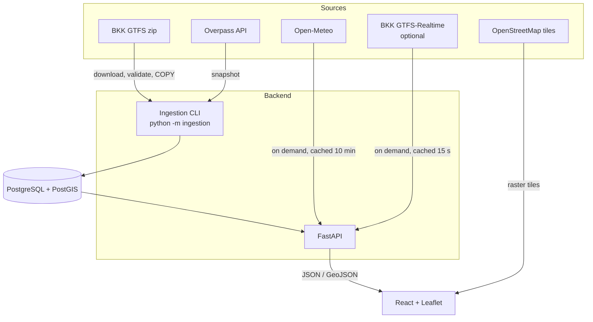
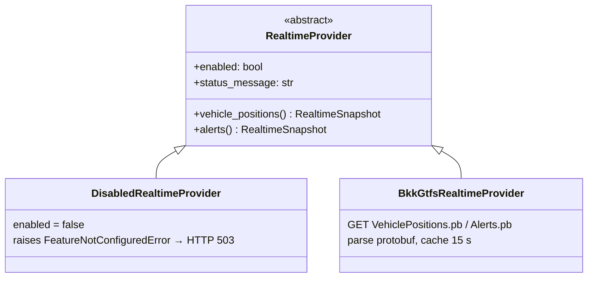

# Architecture

## Overview

### Why the import is separate from the API

The GTFS feed is large (5.7 M stop times) and changes only every few weeks. Importing it inside a web request would be slow and fragile. A command-line job runs the download, validation and bulk load in **one transaction**, and the API only ever reads consistent, fully imported data.

## Backend layers

| Layer | Folder | Responsibility | Example |
| --- | --- | --- | --- |
| Routers | `app/api/` | HTTP: parse and validate parameters, pick status codes | `stops.py` validates `time=HH:MM` |
| Services | `app/services/` | Logic that is not SQL: time maths, external APIs, caching | `departures.py` builds the three service-day windows |
| Repositories | `app/repositories/` | All SQL, nothing else | `stops.stops_geojson()` |
| Schemas | `app/schemas/` | Pydantic response models, which also generate the OpenAPI docs | `DeparturesResponse` |
| Real-time | `app/realtime/` | Provider interface and implementations | `BkkGtfsRealtimeProvider` |

Cross-cutting concerns:
- **Configuration.** `app/config.py` reads everything from environment variables and `.env`. There are no hard-coded secrets, and the database password is a `SecretStr`.
- **Errors.** Domain errors (`UpstreamServiceError`, `FeatureNotConfiguredError`) and database outages are turned into `503` responses with a readable `detail` in `app/main.py`.
- **Logging.** Standard `logging` with timestamps. The importer logs progress and every dropped-row category. API keys are never logged.
- **Validation of external data.** GTFS rows are type-checked with pandas. Open-Meteo and Overpass responses are validated with Pydantic models or explicit checks, so an upstream format change fails loudly (`503`) instead of showing wrong data.

## Frontend structure

| Folder | Responsibility |
| --- | --- |
| `src/api/` | `fetchJson` client (turns error bodies into readable messages) and TypeScript copies of the API models |
| `src/hooks/useApi.ts` | Fetches when the URL changes, cancels outdated requests, supports periodic refresh |
| `src/config/` | Transport-mode colours and zoom thresholds, base maps, layer state and URL (de)serialisation |
| `src/components/map/` | Leaflet layers: stops (loaded for the visible area), routes, selection, urban layers, live vehicles |
| `src/components/panels/` | Stop, route, weather, layer and about panels |
| `src/components/dashboard/` | Statistics bar |
| `App.tsx` | Holds application state: layers, selection, viewport, fly-to requests |

Performance choices:
- The canvas renderer draws thousands of markers efficiently.
- Stops are requested only for the visible area (plus a 15 % margin).
- Low-importance modes appear only when zoomed in: tram from zoom 14, bus and trolleybus from 15.
- Bus and trolleybus route lines are off by default, which avoids drawing 335 overlapping lines.

## Real-time extension (Phase 10)

The system is prepared for live data without faking any:

- `create_realtime_provider()` picks the BKK provider only when `BKK_API_KEY` is set.
- `/api/realtime/vehicles` joins live positions with the static `routes` table (via `route_id`), so vehicles get BKK line numbers and colours.
- Every response carries `data_status`. The UI shows **Live** badges only for real-time data, and the "Live vehicle positions" layer toggle is disabled with an explanation when no key is configured.

### How to enable it
1. Register for a free key at <https://opendata.bkk.hu/>.
2. Add `BKK_API_KEY=<your key>` to `.env` and restart the backend.
3. `GET /api/realtime/status` should report `enabled: true`. Then turn on **Data layers → Real-time → Live vehicle positions**.

### Next steps
| Feature | Approach |
| --- | --- |
| Delays in departures | Parse `TripUpdates.pb` in the same provider. In `services/departures.py`, look up each departure's `trip_id` and add `delay_seconds` and `estimated_time`. When that data is present, set `data_status` to `realtime`. |
| Disruptions in panels | Filter `alerts()` by the stop's or route's IDs (already parsed into `route_ids` / `stop_ids`) |
| Live parking or bike availability | Add further providers behind the same pattern (interface, disabled default, clearly labelled data) |
| Scheduled re-import | Run `python -m ingestion gtfs` nightly (cron or a GitHub Actions schedule). The import is idempotent and skips unchanged files. |
