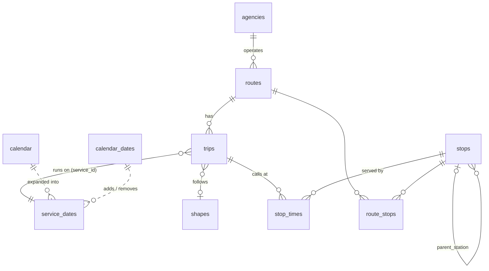

# Database design (PostgreSQL 17 + PostGIS 3.5)

The schema is defined in [`backend/db/schema.sql`](../backend/db/schema.sql). All geometries use **WGS84 (SRID 4326)**, the coordinate system of both GTFS and OpenStreetMap.

## Entity–relationship diagram

## Tables

### Imported from GTFS (replaced completely on each import)

| Table | Rows (Budapest) | Content | Notes |
| --- | ---: | --- | --- |
| `agencies` | 2 | BKK, MÁV-HÉV | |
| `routes` | 389 | Lines | `mode` is derived from `route_type` (BKK uses the extended codes 11 = trolleybus and 109 = HÉV). `geom` is a derived simplified MultiLineString. |
| `stops` | 6,018 | Platforms (`location_type` 0) and stations (1) | `geom` is a Point. Entrances and generic nodes (types 2–4) are not stored. `modes` is derived. |
| `shapes` | 1,593 | One LineString per shape | Built from 715,000 points in `shapes.txt` |
| `trips` | 282,994 | Individual scheduled journeys | |
| `stop_times` | 5,729,142 | When each trip calls at each stop | Times are stored as **seconds since the start of the service day**; they can exceed 86,400 (e.g. `25:10:00` = 90,600) |
| `calendar` | 0 | Weekly service patterns | Optional in GTFS; BKK does not provide it |
| `calendar_dates` | 9,874 | Service added (1) or removed (2) on a date | |

### Derived at import time

| Table / column | Why it exists |
| --- | --- |
| `service_dates (service_date, service_id)` | Answers "which services run on date X?" with a single index lookup. It combines the `calendar` weekly rules with the `calendar_dates` additions and removals. |
| `route_stops (stop_id, route_id)` | Answers "which lines serve this stop?" without scanning 5.7 M `stop_times` rows |
| `stops.modes text[]` | Lets the map filter and colour stops by mode; stations inherit their platforms' modes |
| `routes.geom` | For each route and direction, the shape used by the most trips, simplified by about 2 m. This is what the map draws. |

### Other tables

| Table | Content |
| --- | --- |
| `feed_info` | One row per successful import: feed version, validity dates, source, SHA-256 (used to skip unchanged downloads), import time |
| `urban_pois` | OpenStreetMap features for the urban layers: category, OSM id, name, operator, tags (JSONB), point |
| `urban_layer_imports` | Feature count and OSM data timestamp per layer |

## Relationships

- `routes.agency_id → agencies`
- `trips.route_id → routes`
- `trips.shape_id → shapes`: nulled by the importer if the shape is missing.
- `trips.service_id → service_dates.service_id`: a logical key rather than a foreign key, because a service has many dates.
- `stop_times.trip_id → trips` and `stop_times.stop_id → stops`: **logical** foreign keys. The importer enforces them by dropping orphan rows, which is reported in the import summary. Declaring real FK constraints on this 5.7 M-row table would make the bulk load several times slower.
- `stops.parent_station → stops`: a platform belongs to a station.
- `route_stops → routes, stops`

## Indexes

| Index | Used by |
| --- | --- |
| `stops USING GIST (geom)` | Viewport (`bbox`) queries and the nearby-platform search |
| `stops USING GIN (modes)` | Mode filter (`modes && ARRAY[...]`) |
| `stops (parent_station)` | Station → platform lookups |
| `routes USING GIST (geom)`, `routes (mode)` | Route layers by mode |
| `trips (route_id)`, `trips (service_id)` | Route details; services running on a date |
| **`stop_times (stop_id, departure_secs)`** | **The departures query**: range scan per stop and time window |
| `stop_times` primary key `(trip_id, stop_sequence)` | Ordered stop lists of a trip; the "is this the last stop?" check |
| `service_dates` primary key `(service_date, service_id)` | "Services running today" |
| `urban_pois USING GIST (geom)` | Layer `bbox` queries |

Typical response times on a laptop: departures take about 20 ms, stop details about 15 ms, and all 5,600 stops as GeoJSON about 170 ms (117 KB gzipped).

## How departures are computed

GTFS times are relative to a *service day*, and a trip that runs after midnight belongs to the previous day's service (e.g. `24:30:00`). For a request at time *T*, the backend therefore builds three windows:

| Service date | Window (seconds since that service day started) |
| --- | --- |
| yesterday | `[T + 86400, T + 86400 + window)` catches late-night trips |
| today | `[T, T + window)` |
| tomorrow | `[T − 86400, T − 86400 + window)`, relevant when the window crosses midnight |

It then joins `stop_times → trips → service_dates` and sorts by the seconds from the request time. Wall-clock times are computed using the GTFS rule that the service day starts at *noon minus 12 hours*, which differs from midnight on daylight-saving change days.

## Size

A full Budapest import uses about **0.9 GB** (mostly `stop_times` and its indexes) and takes about 3–4 minutes.
